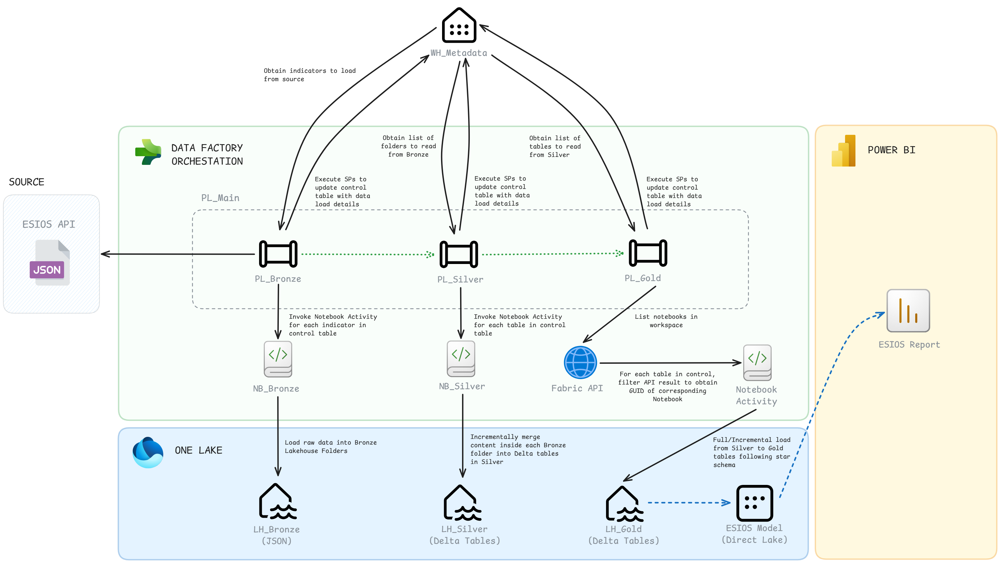

# ESIOS-Fabric-Medallion-Architecture

## Description
ESIOS is the information system of Red Eléctrica de España (REE) for electricity system management and data exploitation.

In this repository, I leverage the public ESIOS API to implement an end-to-end Medallion Architecture data engineering project built on Microsoft Fabric.

### Key features:

* **Metadata-Driven Orchestration:** Utilizes control tables within a metadata warehouse to govern data extraction, loading, and tracking across every stage of the Medallion architecture.
* **Incremental Updates via Watermarks:** Implements high-watermark tracking for incremental data loading, incorporating a safety overlap window to capture late-arriving data.
* **Execution Statistics Extraction:** Collects operational metrics and execution data to monitor pipeline performance and row counts.
* **Dynamic API Notebook Mapping:** Uses the Fabric REST API inside pipelines to dynamically fetch and execute notebooks, ensuring seamless multi-environment deployments.
* **Data Engineering (PySpark):** 
  * *Bronze:* Raw JSON ingestion into OneLake.
  * *Silver:* Data cleansing, deduplication, schema enforcement, and ingestion timestamp generation for data lineage.
  * *Gold:* Dimensional modeling with strict schema enforcement via centralized dictionaries, designed to deliver prepared data optimized for Business Intelligence consumption.
* **Power BI & Analytics:** Semantic model in **DirectLake** mode structured as a star schema, designed to showcase key indicators regarding the state of electricity demand and generation in mainland Spain. Enhanced with **Calculation Groups** for advanced time intelligence, **Field Parameters** for dynamic UX interactivity, custom SVG indicators, and a minimalistic design made in Figma.

## Architecture

## Feedback

If you have any feedback, please reach out to me at martacasdelg@gmail.com

## 🔗 Links

